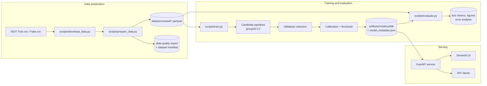

# Fake News Detection System

An end-to-end NLP classification system that estimates whether a news headline
and/or article body resembles the `REAL` or `FAKE` examples in a labelled corpus.
The repository covers data validation, leakage-safe splitting, model comparison,
calibration, held-out evaluation, a FastAPI prediction service, a Streamlit UI,
containerisation and CI.

> **This is a model classification, not a fact-check.** The classifier learns
> writing style, vocabulary and dataset artifacts. It does not verify facts,
> retrieve sources or establish whether a claim is true. See
> [docs/MODEL_CARD.md](docs/MODEL_CARD.md) before using it.

## Contents

- [Overview](#overview)
- [Key features](#key-features)
- [Architecture](#architecture)
- [Technology stack](#technology-stack)
- [Dataset](#dataset)
- [Repository structure](#repository-structure)
- [Installation](#installation)
- [Quick start](#quick-start)
- [Training and evaluation](#training-and-evaluation)
- [Results](#results)
- [API](#api)
- [Streamlit UI](#streamlit-ui)
- [Docker](#docker)
- [Testing and code quality](#testing-and-code-quality)
- [Configuration and security](#configuration-and-security)
- [Limitations](#limitations)
- [Roadmap](#roadmap)
- [Contributing](#contributing)
- [License and acknowledgements](#license-and-acknowledgements)

## Overview

The problem: labelled real/fake news corpora are easy to fit and easy to
overstate. A model can reach very high in-distribution accuracy by learning a
wire-service marker, a publisher's formatting or a topic vocabulary instead of
anything about truthfulness. This project treats that risk as a first-class
engineering problem.

The system:

1. downloads and validates the ISOT "Fake and Real News" corpus;
2. removes exact duplicates and clusters near-duplicates before splitting;
3. produces grouped, stratified train/validation/test splits with an audit that
   verifies no duplicate cluster crosses a boundary;
4. compares a dummy baseline, Logistic Regression, Complement Naive Bayes, a
   Random Forest and a calibrated Linear SVC;
5. selects a model on validation macro-F1, calibrates it, and tunes a decision
   threshold on validation data;
6. evaluates the frozen model once on the test split and reports metrics,
   calibration, latency and error slices;
7. serves the resulting artifact through a validated FastAPI endpoint and a
   Streamlit front end.

Intended users are machine-learning engineers reviewing the project, researchers
who need a reproducible in-distribution baseline, and anyone who wants to see how
a responsible text-classification pipeline is built and documented.

## Key features

- **Leakage-aware data pipeline.** Exact de-duplication plus MinHash/LSH
  near-duplicate clustering, followed by a grouped stratified split. The dataset
  manifest records a leakage audit; the current build reports zero duplicate
  clusters crossing splits.
- **Explicit data quality reporting.** Missing content, short bodies, malformed
  labels, conflicting labels, encoding damage, duplicates, class imbalance and
  dataset artifacts are counted and written to `reports/data_quality_report.md`.
- **Configurable ingestion.** Source files, column names, label maps and date
  formats are declared in `configs/data.yaml`; no schema is hard-coded into the
  loader.
- **Multiple model families.** Dummy reference, Logistic Regression, Complement
  Naive Bayes, Random Forest and calibrated Linear SVC, with grouped
  cross-validation on the training split.
- **Evidence-based selection.** Validation macro-F1 is primary; ties break on
  positive-class F1, p95 latency and artifact size. The test split is untouched
  until evaluation.
- **Calibration and thresholds.** Isotonic calibration and an F1-tuned threshold
  fitted on validation data; the test report includes Brier score, log loss,
  expected calibration error and reliability bins.
- **Rigorous held-out evaluation.** Accuracy, precision, recall, F1, macro and
  weighted F1, per-class metrics, raw and row-normalised confusion matrices,
  ROC-AUC, PR curve/average precision, latency and artifact size.
- **Error analysis by slice.** Performance by subject, document length and model
  confidence, plus the most confident false positives and false negatives.
  Slices below 30 documents are marked unreliable.
- **Versioned, checksummed artifacts.** A single scikit-learn `Pipeline` plus
  metadata containing the dataset fingerprint, seed, package versions, selected
  configuration, metrics and artifact SHA-256.
- **Production-minded API.** Startup model loading, `/health`, `/ready`,
  `/metadata`, `/metrics`, single and batch prediction, strict Pydantic schemas,
  request-size limits, a per-client rate limiter, request IDs, structured JSON
  logs and sanitised error responses.
- **Streamlit front end.** Headline and body inputs, probabilities, an honest
  limitations panel and optional signed TF-IDF feature attribution for linear
  models. All inference is delegated to the API.
- **Reproducible tooling.** Editable package install, layered configuration,
  Ruff, mypy, pytest, Docker and GitHub Actions.

## Architecture



The model artifact is the only object shared between training and serving. The
API loads it once at startup; it never trains, downloads or mutates the model
during a request.

## Technology stack

| Layer | Tools |
|---|---|
| Language | Python 3.11+ |
| Data processing | pandas, NumPy, SciPy, PyArrow (Parquet) |
| Machine learning | scikit-learn (TF-IDF, linear models, Random Forest, calibration, metrics) |
| Configuration | Pydantic v2, pydantic-settings, PyYAML |
| API | FastAPI, Uvicorn |
| UI | Streamlit, Requests |
| Visualisation | Matplotlib, Seaborn |
| Testing and quality | pytest, pytest-cov, httpx, Ruff, mypy |
| Packaging and deployment | setuptools, Docker, Docker Compose, GitHub Actions |

Dependencies are declared in `pyproject.toml` with optional extras: `api`,
`app`, `train`, `dev` and `transformer`. The extras are the single source of
truth; there is intentionally no parallel `requirements/` tree to drift out of
sync.

## Dataset

The project uses the **ISOT Fake and Real News** dataset from the Information
Security and Object Technology lab at the University of Victoria.

- Homepage: <https://onlineacademiccommunity.uvic.ca/isot/2022/11/27/fake-news-detection-datasets/>
- Files: `True.csv` (21,417 rows, Reuters wire copy) and `Fake.csv` (23,481
  rows from outlets flagged by PolitiFact)
- Citation: Ahmed, H., Traore, I., & Saad, S. (2017). *Detection of Online Fake
  News Using N-Gram Analysis and Machine Learning Techniques.*
- License: the distributor does not attach an explicit open-source licence; the
  archive is published for research use. This repository **does not redistribute
  the data**. Review the current terms with the dataset owner before commercial
  use or redistribution.

The download is an explicit step and is not performed by tests or CI:

```bash
python scripts/download_data.py
# or import existing copies
python scripts/download_data.py --from-dir /path/to/csvs
```

After validation and de-duplication, 38,558 of 44,898 rows are retained. The
main exclusions are 5,605 exact duplicate texts and 735 bodies shorter than 40
characters. See `reports/data_quality_report.md` for counts, length statistics,
temporal coverage, label balance and dataset artifacts.

### Important artifacts in this corpus

- 99.82% of `REAL` rows contain the Reuters wire marker, versus 1.31% of `FAKE`
  rows.
- `REAL` and `FAKE` use disjoint `subject` values.
- `FAKE` contains body-less rows; `REAL` does not.

These properties make in-distribution accuracy an upper bound, not a
generalisation estimate. The project reports them rather than hiding them.

## Repository structure

```text
fake-news-detection-system/
├── app/
│   └── streamlit_app.py          # UI; calls the API, never loads the model
├── configs/
│   ├── data.yaml                 # sources, validation, splitting
│   ├── training.yaml             # features, candidates, selection, calibration
│   └── inference.yaml            # documented serving defaults
├── data/                         # raw and processed data (git-ignored)
├── docs/
│   └── MODEL_CARD.md             # intended use, metrics, biases, limitations
├── reports/                      # generated quality/evaluation reports (git-ignored)
├── scripts/
│   ├── download_data.py
│   ├── prepare_data.py
│   ├── train.py
│   └── evaluate.py
├── src/fake_news_detection/
│   ├── api/                      # FastAPI app, schemas, service, middleware
│   ├── data/                     # ingestion, validation, preprocessing, splitting
│   ├── evaluation/               # metrics, calibration, error analysis, reporting
│   ├── features/                 # TF-IDF construction and attribution
│   ├── models/                   # candidates, training, inference, registry
│   ├── monitoring/               # structured logging and latency tracking
│   ├── config.py                 # typed YAML/environment configuration
│   └── utils.py
├── tests/
│   ├── unit/
│   ├── integration/
│   └── test_data/
├── Dockerfile                    # multi-target API and Streamlit images
├── docker-compose.yml
├── Makefile
├── pyproject.toml
└── .github/workflows/ci.yml
```

## Installation

### Prerequisites

- Python 3.11 or newer (3.12 is used in the container and CI)
- `pip` and a virtual environment
- Docker only if you want the containerised deployment

### Local setup

```bash
git clone <your-fork-url> fake-news-detection-system
cd fake-news-detection-system

python -m venv .venv
# Windows PowerShell
.venv\Scripts\Activate.ps1
# macOS / Linux
source .venv/bin/activate

python -m pip install --upgrade pip
python -m pip install -e ".[dev,api,app,train]"
```

Copy the example environment file if you want to override defaults:

```bash
# Windows
copy .env.example .env
# macOS / Linux
cp .env.example .env
```

The defaults work for local development; `.env` is git-ignored.

## Quick start

```bash
# 1. Fetch the corpus (explicit download; ~116 MB of CSV)
python scripts/download_data.py

# 2. Validate, de-duplicate and split it
python scripts/prepare_data.py

# 3. Train, compare, calibrate and select a model
python scripts/train.py

# 4. Evaluate the frozen model on the test split (once)
python scripts/evaluate.py

# 5. Serve it
uvicorn fake_news_detection.api.main:app --host 127.0.0.1 --port 8000

# 6. In a second terminal, start the UI
streamlit run app/streamlit_app.py
```

Open <http://127.0.0.1:8000/docs> for the OpenAPI UI and
<http://127.0.0.1:8501> for the Streamlit app.

The equivalent Make targets are `make data`, `make train`, `make evaluate`,
`make api` and `make app`. On Windows without `make`, use the Python commands
above.

## Training and evaluation

### Configuration

`configs/data.yaml` controls sources, column mapping, validation thresholds,
preprocessing and split strategy. `configs/training.yaml` controls TF-IDF
settings, candidates, cross-validation, selection, calibration and the threshold
grid. Both files are validated by typed Pydantic models; unknown keys fail
loudly.

### Commands

```bash
python scripts/prepare_data.py            # add --ablation for a leakage comparison
python scripts/train.py                   # full run
python scripts/train.py --quick 3000      # smoke run; metrics are not results
python scripts/train.py --candidates logistic_regression complement_nb
python scripts/evaluate.py                # test split, exactly once
python scripts/evaluate.py --error-examples 20
```

### Evaluation hygiene

- Exact duplicates are removed and near-duplicates are clustered **before**
  splitting.
- The split is grouped by `dup_cluster` and stratified by label.
- TF-IDF, feature selection, classifiers and calibration are fitted on training
  or validation data only.
- Model selection, calibration and threshold tuning use the validation split.
- The test split is read once by `scripts/evaluate.py`. Its metrics do not feed
  back into the model.
- The positive class for binary metrics is explicitly `FAKE`.

### Generated artifacts

| Path | Contents |
|---|---|
| `data/processed/{train,validation,test}.parquet` | Leakage-safe splits |
| `data/processed/dataset_manifest.json` | Fingerprint, split sizes, leakage audit |
| `reports/data_quality_report.{md,json}` | Validation, duplicates, artifacts |
| `reports/training_report.{md,json}` | Candidate comparison and validation metrics |
| `reports/model_selection.json` | Selection criterion and winner |
| `reports/test_evaluation.{md,json}` | Final test metrics and error analysis |
| `reports/figures/*.png` | Confusion matrices, ROC/PR, reliability, threshold sweep |
| `artifacts/model.joblib` | Serialised inference pipeline |
| `artifacts/model_metadata.json` | Version, checksum, metrics, provenance |

## Results

### Final test-set performance

The selected model is the calibrated Linear SVC (`linear_svc_calibrated`,
v1.0.0) with a validation-tuned decision threshold of **0.40**. It was evaluated
once on the 5,783-row test split (2,607 `FAKE`, 3,176 `REAL`).

| metric | value |
|---|---|
| accuracy | **0.9950** |
| balanced accuracy | 0.9947 |
| precision (`FAKE`) | 0.9973 |
| recall (`FAKE`) | 0.9916 |
| F1 (`FAKE`) | 0.9944 |
| macro F1 | **0.9949** |
| weighted F1 | 0.9950 |
| ROC-AUC | 0.9995 |
| average precision | 0.9991 |
| Brier score | 0.0040 |
| log loss | 0.0195 |
| expected calibration error | 0.0024 |
| p50 / p95 latency | 6.15 ms / **10.58 ms** |
| artifact size | 9.46 MiB |

Raw confusion matrix (rows = actual, columns = predicted):

| actual \ predicted | FAKE | REAL |
|---|---|---|
| FAKE | 2,585 | 22 |
| REAL | 7 | 3,169 |

Row-normalised error rates are 0.84% for `FAKE` and 0.22% for `REAL`.

### Validation comparison

All candidates were fitted on the training split and compared on the 5,784-row
validation split. The test split was not involved.

| candidate | macro-F1 | F1 (`FAKE`) | p95 latency | artifact size |
|---|---|---|---|---|
| `linear_svc_calibrated` | **0.9960** | 0.9956 | 15.30 ms | 9.46 MiB |
| `logistic_regression` | 0.9913 | 0.9904 | 6.83 ms | 5.81 MiB |
| `random_forest` | 0.9904 | 0.9894 | 135.53 ms | 22.56 MiB |
| `complement_nb` | 0.9685 | 0.9650 | 15.19 ms | 13.50 MiB |
| `dummy` (prior) | 0.3545 | 0.0000 | 24.34 ms | 3.62 MiB |

The Linear SVC was selected on validation macro-F1. Logistic Regression remains
the better choice when p95 latency and artifact size matter more than the last
few tenths of a point.

### Interpreting the numbers

- Metrics are computed on a duplicate-grouped, but still random, split of one
  corpus. They measure in-distribution performance.
- The corpus contains strong source and topic artifacts (see
  [Dataset](#dataset)). The 0.995 test accuracy is an upper bound and **not**
  evidence that the model generalises to new publishers.
- Calibrated probabilities describe the evaluation distribution, not the truth
  of an article.
- Error slices with fewer than 30 documents are reported but flagged as
  unreliable.

Full reports: `reports/test_evaluation.md`, `reports/test_evaluation.json`,
`reports/training_report.md` and `reports/model_selection.json`.

## API

Start the service after training:

```bash
uvicorn fake_news_detection.api.main:app --host 127.0.0.1 --port 8000
```

### Endpoints

| Method | Path | Purpose |
|---|---|---|
| `GET` | `/health` | Liveness; process is up |
| `GET` | `/ready` | Readiness; model is loaded (503 otherwise) |
| `GET` | `/metadata` | Safe model metadata and validation/test metrics |
| `GET` | `/metrics` | In-process request and latency counters |
| `POST` | `/predict` | Classify one article |
| `POST` | `/predict/batch` | Classify up to `FND_MAX_BATCH_SIZE` articles |
| `GET` | `/` | Service banner and endpoint list |

### Single prediction

```bash
curl -X POST http://127.0.0.1:8000/predict \
  -H "Content-Type: application/json" \
  -d '{
    "title": "Council approves annual budget after two-hour debate",
    "text": "The city council approved the annual budget on Tuesday after a two-hour debate. Officials said the new spending plan takes effect next month."
  }'
```

Response fields (abridged live response from v1.0.0 for the request above; the
request ID is generated per request and elided here):

```json
{
  "prediction": "REAL",
  "probabilities": {
    "FAKE": 0.0006958942240778976,
    "REAL": 0.9993041057759221
  },
  "score": 0.0006958942240778976,
  "positive_label": "FAKE",
  "decision_threshold": 0.4,
  "model_version": "1.0.0",
  "model_name": "linear_svc_calibrated",
  "request_id": "req_<generated>",
  "disclaimer": "This is a model classification based on statistical patterns learned from a labelled corpus, not independent verification of factual accuracy.",
  "attribution": null
}
```

`score` is the probability of the positive class (`FAKE`). The predicted label
is `REAL` when that score is below the decision threshold.

### Batch prediction

```bash
curl -X POST http://127.0.0.1:8000/predict/batch \
  -H "Content-Type: application/json" \
  -d '{"items": [{"title": "Headline one"}, {"text": "A longer article body."}]}'
```

### Optional feature attribution

Set `"explain": true` on a single prediction. For linear models the response
includes signed TF-IDF contributions; for other models it reports
`"supported": false` with the reason. Attribution is a model explanation, not
evidence about factual accuracy.

### Error behaviour

- `400` — service-level rejection after schema validation (for example an
  unusable input reaching the predictor)
- `413` — request body over `FND_MAX_REQUEST_BYTES`
- `422` — schema validation failure, including empty input, oversized fields,
  unknown fields and an empty or oversized batch
- `429` — rate limit exceeded (with `Retry-After`)
- `503` — model not loaded; check `GET /ready`

Request bodies are not logged by default (`FND_LOG_REQUEST_BODIES=false`).

## Streamlit UI

```bash
uvicorn fake_news_detection.api.main:app --port 8000
streamlit run app/streamlit_app.py
```

Set `FND_API_BASE_URL` if the API is not at `http://127.0.0.1:8000`. The UI
shows the model version and threshold, validates input before sending it,
displays class probabilities, optionally renders linear-model attribution, and
keeps the "not a fact-check" caveat visible with every result.

## Docker

Train first so that `artifacts/model.joblib` exists. The Compose stack mounts
that directory read-only into the API container, which keeps the model
independently versioned and rollback-friendly.

```bash
python scripts/train.py
python scripts/evaluate.py
docker compose up --build
```

- API: <http://localhost:8000>
- UI: <http://localhost:8501>

Stop with `docker compose down`. Build only the API image with
`docker build --target api -t fake-news-detection-api .`.

The API image runs as a non-root user, exposes a health check against `/health`,
and does not include training dependencies. The Streamlit image is a separate
build target.

## Testing and code quality

```bash
python -m pytest
python -m pytest --cov=fake_news_detection --cov-report=term-missing
python -m ruff check .
python -m ruff format --check .
python -m mypy src
```

Or use `make test`, `make lint`, `make format` and `make typecheck`.

The suite uses synthetic fixtures and never downloads the corpus. It covers text
normalisation, label mapping, validation, duplicate detection, grouped splitting
and leakage audits, feature extraction, artifact save/load and checksum
validation, prediction consistency, API success and failure paths, readiness
before and after loading, and the Streamlit helper layer.

GitHub Actions (`.github/workflows/ci.yml`) runs linting, formatting, mypy, the
test suite and a compile/startup smoke test on Python 3.11 and 3.12. Expensive
training is deliberately not part of CI.

The full run reported in this README was produced with Python 3.14.3,
scikit-learn 1.9.1, pandas 3.0.5, FastAPI 0.141.1 and Streamlit 1.64.0. The
exact package versions, dataset fingerprint, seed and feature configuration are
recorded in `artifacts/model_metadata.json` (`package_versions`, `dataset`,
`training` and `feature_config`). The container and CI use Python 3.12.

## Configuration and security

Runtime settings are read from environment variables with the `FND_` prefix
(see `.env.example`). Important values:

| Variable | Default | Meaning |
|---|---|---|
| `FND_ARTIFACT_DIR` | `artifacts` | Directory containing the model |
| `FND_MODEL_ARTIFACT` | `model.joblib` | Model filename |
| `FND_MODEL_METADATA` | `model_metadata.json` | Metadata filename |
| `FND_DECISION_THRESHOLD` | unset | Override the metadata threshold |
| `FND_MAX_TITLE_CHARS` | `512` | Headline limit |
| `FND_MAX_TEXT_CHARS` | `20000` | Body limit |
| `FND_MAX_REQUEST_BYTES` | `262144` | Request-size limit |
| `FND_MAX_BATCH_SIZE` | `64` | Batch limit |
| `FND_RATE_LIMIT_*` | `60/min` | In-process rate limit |
| `FND_LOG_REQUEST_BODIES` | `false` | Never log articles by default |

Security notes:

- Artifacts use `joblib`/pickle. Only load artifacts produced by this repository
  from a trusted location. The loader verifies a SHA-256 recorded in metadata to
  detect corruption, but that is not a cryptographic signature.
- The service does not expose filesystem paths or raw exceptions in responses.
- Input length and request size are bounded; batch size is bounded.
- The rate limiter is per process. Behind multiple replicas, enforce limits at
  the ingress or with a shared store.
- Secrets belong in environment variables or a secret manager; never commit
  `.env`.

### Model updates and rollback

1. Bump `model_version` in `configs/training.yaml`.
2. Re-run `prepare_data.py` if the corpus or split logic changed.
3. Run `train.py`, inspect `reports/training_report.md`, then run `evaluate.py`
   once and inspect the test report.
4. Keep the previous `model.joblib` and `model_metadata.json` pair as the
   rollback target.
5. Restart the service and confirm `GET /ready` is 200 and `GET /metadata`
   reports the expected version.

Rollback means restoring the previous artifact/metadata pair and restarting.
The files must be restored together: the metadata records the artifact checksum
and the two are verified on load.

## Limitations

- The classifier can learn dataset artifacts and publisher style rather than
  factual correctness.
- Evaluation is in-distribution: grouped by duplicate cluster, but not
  source-held-out or temporal.
- The corpus is English and concentrated in 2015–2017.
- Labels are dataset labels, not adjudicated ground truth.
- A high probability is not independent evidence of truth or deception.
- v1.0.0 has no out-of-distribution detector and no drift monitoring.
- Headline-only inputs carry much less signal than full articles.

The full model card is [docs/MODEL_CARD.md](docs/MODEL_CARD.md). The executed
commands, verification results and known gaps are recorded in
[docs/ENGINEERING_REPORT.md](docs/ENGINEERING_REPORT.md).

## Roadmap

Planned, not implemented:

- Source-held-out and temporal evaluation splits, with a comparison against the
  current random grouped split.
- Out-of-distribution and drift detection on input length, vocabulary and
  predicted-class distribution.
- Fine-tuning a compact transformer (DistilBERT) with the same evaluation
  protocol; the `transformer` extra exists but is not used by v1.0.0.
- Signed model artifacts and a promotion/rollback workflow.
- Multilingual evaluation.

## Contributing

1. Create a virtual environment and install the `dev`, `api` and `app` extras.
2. Make the change with tests.
3. Run `python -m ruff format .`, `python -m ruff check .`, `python -m mypy src`
   and `python -m pytest`.
4. Open a pull request describing the change and its evaluation impact.

Please do not add claims or metrics that were not produced by the pipeline, and
do not commit datasets, artifacts, secrets or user text.

## License and acknowledgements

The source code is released under the MIT License (see [LICENSE](LICENSE)). The
dataset is not covered by that license and is not redistributed.

Thanks to the ISOT lab at the University of Victoria for publishing the corpus,
and to the scikit-learn, FastAPI, Streamlit and pandas maintainers.
